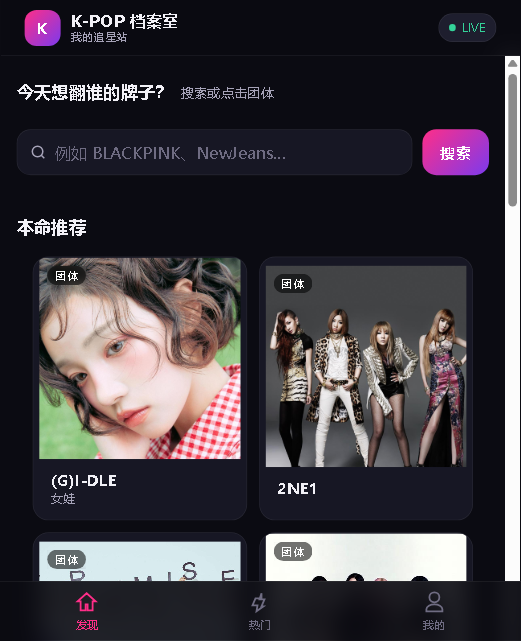

# K-POP 档案室 · kpop-archive

[](https://github.com/VTO-123/kpop-archive/actions/workflows/ci.yml)
[](https://github.com/VTO-123/kpop-archive/actions/workflows/docker-image.yml)


> 输入任意 K-POP 团体/歌手名，AI 流式生成入坑档案，歌曲直接跳转 B 站观看。移动端 C 端粉丝 App（PWA），前后端同仓的单体工程。

**在线 Demo（移动端，手机浏览器打开可直接添加到主屏幕）：** <https://uimcwuhdrtyc.sealoshzh.site> · **仓库地址：** <https://github.com/VTO-123/kpop-archive>



---

## 一、为什么做这个项目

追 K-POP 的人想快速了解一个陌生团体的出道时间、成员和代表作，这些信息往往散落在百科、音乐平台和视频站。

于是做了这个：搜一个名字，拿到一份可追溯来源的完整档案，歌曲还能直接跳到 B 站看 MV。

它先是我的自用工具，后来分享给同好，也顺手把「移动端 C 端 App、前后端同仓、一个进程跑完、带账号体系」的工程实践放了进来。

个人兴趣项目，持续按真实资料迭代。

## 二、30 秒跑起来

```bash
npm install
npm start
# 浏览器打开 http://localhost:4321（手机同网段访问同一地址即移动端版式）
```

- 要求 **Node.js ≥ 18.17**（使用内置 `fetch` / `AbortSignal.timeout`）。
- **无需数据库、无需 API Key 即可体验**：没配 Key 会自动进入演示模式；歌手库里的 92 位歌手/团体直接出档案，冷门歌手也会实时查百科与网易云。
- 配置 `.env.local` 后启用模型补写：公开资料都查不到的名字，交给模型按同一套字段约束补全。

```bash
cp .env.example .env.local    # Windows PowerShell: Copy-Item .env.example .env.local
```

```ini
AI_API_KEY=sk-xxxxxxxx
AI_BASE_URL=https://your-gateway.example.com/v1
AI_MODEL=your-model
```

自检（会真的拉起服务，随机端口、强制 DEMO）：

```bash
npm run smoke
```

## 三、核心能力

1. **AI 流式档案**：输入任意真实歌手/团体名（中英文均可），SSE 逐字生成——一句话定性 / 团体档案 / 热门歌曲 / 入坑观看 / 冷知识。
2. **多源资料聚合**：内置精选（92 位歌手/团体）+ 网易云 + QQ 音乐 + 百度百科 + AI 兜底，五层取数自动降级，冷门歌手也能查到；抓到的真实资料不足时，交给模型按同一套模板补全成稿。
3. **歌名直跳 B 站**：bvid 直链 → B 站搜索接口 → 搜索页，三级策略；无匹配自动跳 B 站搜索。
4. **资料溯源**：资料速览与奖项逐项标注来源（百度百科 / 网易云等），拿不到显示「暂未收录」，不编造信息。
5. **成员互链**：组合成员名可点进各自档案页。
6. **页内播放器**：歌曲页内嵌 B 站播放器，不跳转也能看。
7. **移动端 C 端 App（PWA）**：手机浏览器访问即移动端版式（发现 / 热门 / 我的 三 tab），可添加到主屏幕全屏使用，无需上架应用商店。
8. **账号体系**：注册 / 登录（scrypt 密码哈希 + Bearer token），收藏、最近看过、搜索历史云端存储，每个账号数据独立隔离；档案支持复制 / 下载 `.md`、生成分享链接。

## 四、技术特色

- **前后端同仓单体工程**：一个 Node 原生进程、默认 `4321` 一个端口，同时托管 `public/` 静态资源与 `/api/*` 路由；零 Express / Next.js，运行时零第三方依赖。
- **移动端 PWA**：`public/manifest.json` 声明应用名 / 图标 / 全屏模式，手机可「添加到主屏幕」以 App 形态运行；移动端三 tab（发现 / 热门 / 我的）用 hash 路由单页切换，`mobile.css` 单独适配触屏。
- **账号体系**：`src/auth.js` 注册 / 登录 / 鉴权——密码 `scrypt` 加盐哈希（不存明文）、`Bearer` token 会话（30 天过期）、用户名正则 `^[A-Za-z0-9_\u4e00-\u9fa5]{2,20}$` 校验天然防目录穿越；`src/userstore.js` 把每个账号的收藏 / 最近 / 搜索历史落盘到 `data/users/<用户名>.json`，各去重置顶、上限 20 条，`.gitignore` 排除用户数据绝不入库。
- **SSE 流式响应**：`src/chat.js` 直接写 `text/event-stream`，按 `data: {"type":"delta"}` 逐字下发，15 秒心跳；客户端 `AbortController` 可中断，已输出内容保留；无 Key 自动切 DEMO 流式语料。
- **多源数据层**：`src/sources.js` 判定来源，`src/artist-profile.js` 聚合百度百科 / 网易云 / QQ 音乐，`src/bilibili.js` 聚合 B 站；每源独立超时（4.5–5s）、内存缓存与并发去重（inflight），百科与 B 站另做 10 分钟失败短缓存。
- **OpenAI 兼容 Provider，可插拔**：只依赖 `/chat/completions` 协议，`AI_BASE_URL` + `AI_MODEL` + `AI_API_KEY` 配置化，DeepSeek / OpenAI / 任意兼容网关都能接；Key 只在服务端。
- **真实性优先**：资料字段带 `source`，页面逐项标注；确认不了就返回「暂未收录」；模型只在公开资料都拿不到时兜底，prompt 约束「不确定写不详、不许虚构成员/年份/作品」。
- **B 站三级跳转策略**：内置 `bvid` 映射 → 搜索接口命中取 `bvid`（浏览器 UA + `buvid3/buvid4` 指纹 Cookie）→ 关键词搜索页兜底；关键词自动处理「英文补 MV、括号版本取主标题、remix 去后缀」。
- **CI/CD 发布链路**：`ci.yml` 跑 `npm ci + smoke + 启动探活`，`docker-image.yml` 跑 smoke 后用 buildx 推送 `vtobbb/kpop-archive:latest` 到 Docker Hub；Sealos 拉镜像部署，国内直连。
- **安全实践**：密钥只放本地 `.env.local`，已被 `.gitignore` 排除，仓库只提交 `.env.example` 占位；图片代理走域名白名单（`hdslb.com` / `music.126.net` / `bcebos.com` / `bdimg.com`），静态服务做路径穿越校验，代理限 8 秒 / 8MB。

## 五、技术决策与踩坑

- **为什么不用数据库**：档案数据只读、量小、几乎不写；`data/groups.json` + `data/songs.json` 随仓库发布，配合运行时聚合就够了。账号数据（收藏 / 最近 / 搜索）也是单机小文件，每账号一个 JSON 顺序读写即可，省掉 DB 进程、迁移脚本和备份，Docker 镜像一次构建到处跑；量级到需要并发事务时再换数据库不迟。
- **为什么不用框架**：这个体量不需要全家桶。原生 `node:http` 把路由、静态托管、SSE、超时与优雅退出摊在两百多行里，问题边界清楚、冷启动直接；`Content-Length` / `HEAD` / `text/event-stream` / 反向代理缓冲这些 HTTP 细节也都能自己控制。
- **外部数据不稳定**：网易云 / QQ 音乐 / B 站 / 百科都会偶发超时、412、403，模型还会把出道年份、成员「补全」错。接入层给每个源独立超时、缓存、并发去重和降级；内容层先聚合真实资料，有资料就直接成稿，没资料才交给模型，字段缺失一律「暂未收录」并标来源。
- **容器内的静态资源路径**：本地启动和容器内的工作目录可能不同，用 `process.cwd()` 拼路径会 404。`src/config.js` 用 `import.meta.url` 计算项目根目录的绝对路径，`public/` 与 `data/` 都不依赖启动目录；`Dockerfile` 再加 `HEALTHCHECK` 轮询 `/api/config`，容器自带上报健康状态。

## 六、架构图

```text
浏览器（手机/桌面） ──HTTP:4321──> server.js（Node 单进程：静态托管 + API 路由 + SSE + 鉴权）
                          ├── public/  前端：移动端壳（发现/热门/我的）+ 档案/歌曲页 + PWA manifest
                          ├── src/     后端：chat(SSE) / netease / qqmusic / baike / bilibili / auth / userstore
                          └── data/    数据：groups / songs / images（只读）+ users（每账号动态写入）
```

请求只经过一个进程：静态资源直接从 `public/` 输出，页面壳由 `artist-page.js` / `song-page.js` 做服务端注入，正文走 `/api/chat` 的 SSE，数据源在 `src/` 内按优先级聚合；账号相关接口走 `src/auth.js` + `src/userstore.js`，数据按用户名隔离写入 `data/users/`。

## 七、目录结构

```text
kpop-archive/
├── server.js                # HTTP 入口：路由 / 静态托管 / SSE / 优雅退出
├── src/
│   ├── chat.js              # /api/chat：SSE 转发、超时、错误映射
│   ├── sources.js           # 来源判定：歌手库 / 实时资料 / 模型兜底
│   ├── profile.js           # 资料字段 → 带来源的档案 Markdown
│   ├── artist-profile.js    # 资料聚合：歌手库 → 百科 → 网易云
│   ├── baike.js             # 百度百科词条层（5s 超时 / 缓存 / 同名过滤）
│   ├── bilibili.js          # B 站三级跳转（bvid / 搜索接口 / 搜索页）
│   ├── netease.js           # 网易云歌手 / 专辑 / 热歌
│   ├── qqmusic.js           # QQ 音乐歌手简介 / 热歌
│   ├── groups.js            # 歌手库读取、别名归一化
│   ├── songs.js             # 热门视频数据与链接映射
│   ├── cover.js             # 封面兜底（网易云 → QQ → 百科）
│   ├── image-proxy.js       # /api/img 同源代理（域名白名单）
│   ├── auth.js              # 注册 / 登录 / Bearer token 鉴权（scrypt 哈希）
│   ├── userstore.js         # 每用户云端数据：收藏 / 最近 / 搜索历史
│   ├── artist-page.js       # /artist/[name] SSR 注入
│   ├── song-page.js         # /song/[id] SSR 注入
│   ├── demo.js              # 8 个团体的内置档案语料
│   └── static.js            # 静态文件服务（路径穿越防护）
├── public/
│   ├── index.html           # 移动端壳：发现 / 热门 / 我的 三 tab（PWA manifest）
│   ├── artist.html          # 档案页模板
│   ├── song.html            # 歌曲页模板
│   ├── app.js               # 移动端单页逻辑：路由 / 登录 / 云端同步
│   ├── artist.js            # 档案页：流式渲染 / 成员链接 / B 站解析
│   ├── song.js              # 歌曲页：内嵌 B 站播放器
│   ├── js/                  # md / stream / store
│   ├── mobile.css           # 移动端触屏适配（发现 / 热门 / 我的）
│   └── manifest.json        # PWA：应用名 / 图标 / 全屏模式
├── data/
│   ├── groups.json          # 92 位歌手/团体：资料 + 封面 + 成员
│   ├── songs.json           # 80 首热门 MV：歌名 / 歌手 / 封面 / bvid
│   ├── kpop_images.json     # 13 个团体的图片池（备用）
│   └── users/               # 运行时生成：每用户账号数据（不入库）
├── scripts/
│   ├── fetch-artists.mjs    # 资料抓取（npm run data:artists）
│   └── smoke.mjs            # 端到端自检（npm run smoke）
├── .github/workflows/
│   ├── ci.yml               # npm ci + smoke + 启动探活
│   └── docker-image.yml     # smoke + 构建并推送 Docker 镜像
├── Dockerfile               # node:20-alpine + HEALTHCHECK
└── .env.example             # 配置占位模板
```

## 八、接口文档

| 方法 | 路径 | 用途 |
| --- | --- | --- |
| GET | `/api/config` | 运行模式与 Provider 信息（不含 Key） |
| POST | `/api/chat` | SSE 流式档案 |
| GET | `/api/artist-profile` | 资料速览 / 奖项 / 来源标注 |
| GET | `/api/bilibili` | 歌曲的 B 站三级跳转解析 |
| GET | `/api/cover` | 封面兜底 |
| GET | `/api/songs` | 首页热门视频 |
| GET | `/api/song-links` | 歌名 → bvid 映射 |
| GET | `/api/artists` | 搜索联想用的歌手索引 |
| GET | `/api/members` | 成员 → 个人档案链接 |
| POST | `/api/register` | 注册（scrypt 哈希落盘，签发 token） |
| POST | `/api/login` | 登录（校验密码，签发 token） |
| GET | `/api/me` | 当前账号的收藏 / 最近 / 搜索历史 |
| GET·POST·DELETE | `/api/me/favorites` | 收藏列表增删查 |
| POST | `/api/me/recent` | 写入最近看过 |
| POST·DELETE | `/api/me/searches` | 搜索历史增删 / 清空 |
| GET | `/api/img` | 图片同源代理 |
| GET | `/api/images` | 图片池（备用） |
| GET | `/artist/:name` | 歌手档案页（SSR 壳） |
| GET | `/song/:id` | 歌曲详情页（SSR） |

账号接口统一 `Authorization: Bearer <token>`，未带或过期返回 401；用户名规则 `^[A-Za-z0-9_\u4e00-\u9fa5]{2,20}$`，密码 6-64 位。每个账号的数据独立存储于 `data/users/<用户名>.json`，互相不可见。

### `POST /api/chat`

请求体只有歌手名：

```json
{ "group": "BLACKPINK" }
```

响应为 `text/event-stream`，每行一个事件：

```text
data: {"type":"meta","source":"builtin","kind":"profile","sources":["baike","netease","bilibili"]}

data: {"type":"delta","text":"## 一句话\n"}

data: {"type":"delta","text":"四个人的气场各不相同…"}

data: {"type":"done"}
```

- `meta.source`：`builtin`（歌手库 / 实时资料，不调用模型）或 `ai`（模型补写）。
- `meta.kind`：`builtin`（人工整理语料）/ `profile`（歌手库资料）/ `live`（实时抓取）/ `ai`。
- `meta.sources`：本次实际用到的资料源，页面据此生成来源标注。
- 生成前可能先发一条 `context` 事件（`grounded` / `profileName` / `sources`）。
- 连接期间每 15 秒发送一次 `: ping` 心跳；出错以 `{"type":"error","message":"..."}` 收尾。
- 未配 Key 且所有资料源都没有结果时，返回明确的错误事件，而不是编造一份档案。

### `GET /api/artist-profile?name=<歌手名>`

档案页「资料速览」的数据源：

```json
{
  "name": "ATEEZ",
  "type": "group",
  "facts": [{ "label": "出道时间", "value": "2018 年 10 月 24 日", "source": "baike" }],
  "awards": ["2020年MAMA Worldwide Fans Choice"],
  "songs": ["Answer", "WAVE"],
  "stage": { "title": "ATEEZ 代表舞台", "url": "https://www.bilibili.com/video/BV…", "source": "bilibili" },
  "sources": ["baike", "netease", "bilibili"],
  "sourceLine": "资料参考：百度百科 · 网易云音乐 · B站"
}
```

- 歌手库里有资料时直接返回，**0 次外部请求**；
- 库里没有时实时抓百度百科词条（简介 + 信息卡）与网易云歌手资料，任一成功即可；
- 每条 `fact` 都带 `source`，页面逐项标注「百度百科 / 网易云音乐」；
- 抓不到的字段不返回，页面统一显示「暂未收录」。

百科层用的是词条卡片接口 `BaikeLemmaCardApi`，只读简介与信息卡（组合成员 / 成立时间 / 经纪公司 / 代表作品 / 主要成就 / 首图）：带浏览器 UA 与 Referer、5 秒超时、命中缓存 6 小时、失败缓存 10 分钟；接口失败或同名非艺人（例如「太阳」命中恒星词条）时静默返回空。

### `GET /api/bilibili?artist=&title=&bvid=`

按三级策略解析一首歌的 B 站地址：

1. 传了合法 `bvid` → 直接返回 `https://www.bilibili.com/video/{bvid}`（`mode: mapped`）；
2. 没有 `bvid` → 服务端用「歌名 + 歌手」查 B 站搜索接口（纯英文歌自动补 `MV`，带括号的版本号只取主标题），命中取第一条视频（`mode: search`）；请求带浏览器 UA 与 `buvid3/buvid4` 指纹 Cookie，5 秒超时；
3. 搜索无结果或接口异常 → 静默退到 `https://search.bilibili.com/all?keyword=…`（`mode: search-page`）。

```json
{ "url": "https://www.bilibili.com/video/BV1…", "bvid": "BV1…", "mode": "search", "keyword": "BAD ATEEZ MV" }
```

同一首歌结果缓存 6 小时，失败只缓存 10 分钟。档案页歌名点击与歌曲详情页的「去 B 站看视频」共用这套逻辑。

### `GET /api/cover?name=<团体名>`

封面兜底接口，返回 `{ name, url, source }`，`source` 为 `builtin` / `netease` / `qqmusic` / `baike` / `none`。

内置 `data/groups.json` 命中时不请求图源；否则依次尝试网易云歌手头像、QQ 音乐头像、百度百科词条首图，结果按团体名（忽略大小写与空格）缓存：命中 6 小时、未命中 10 分钟，并做并发去重。百科首图只接受 `*.bcebos.com` / `*.bdimg.com` 的 https 地址。

### `GET /api/songs` 与 `GET /api/song-links`

- `/api/songs`：移动端「热门」tab 的热门 MV 列表，`src` 已换成 `/api/img?...` 同源代理地址（图源直连会偶发限流，统一走代理转发）。
- `/api/song-links`：返回 `{ total, links: { <规范化歌名>: { title, artist, bvid } } }`。前端渲染时按歌名查表：有 `bvid` 直接生成视频页链接，没有则带上歌名与歌手，点击时交给 `/api/bilibili` 解析。

### `GET /api/members`

成员名单映射，返回 `{ total, members: [{ name, group }] }`。档案页把命中的成员名渲染成 `<a href="/artist/{成员名}">`，点进去就是该成员的个人档案页。

### `GET /api/img?u=<编码后的图片地址>`

图片同源代理。WebGL 纹理要求同源，且图源对浏览器直连会偶发 412 限流，所以图片统一经由这里转发：

- 只允许 `*.hdslb.com` / `*.music.126.net` / `*.bcebos.com` / `*.bdimg.com` 的 https 地址，其余返回 403（不是开放代理）；
- 8 秒超时、8MB 上限、30 分钟内存缓存，命中后返回 `X-Cache: HIT`；
- 响应带 `Access-Control-Allow-Origin: *` 与 `Cache-Control: public, max-age=86400`。

### `GET /api/images`

图片池，返回 `{ total, items: [{ src, sourceUrl, title, caption, source }] }`。`src` 已经是 `/api/img?...` 的同源代理地址，`sourceUrl` 是原始图源（13 个团体混合池，当前首页不直接用）。

### 页面路由

- `/artist/[name]`：服务端注入 `<title>`、`og:image`、封面、资料速览与来源标注，正文由浏览器端走 `/api/chat` 流式填充。`[name]` 支持中文与别名（`/artist/粉墨` 会按 BLACKPINK 渲染）；`/artist` 或非法路径 302 回首页。
- `/song/[id]`：服务端注入歌名 / 歌手 / 封面 / 简介与三个入口——「播放 MV」页内嵌 `https://player.bilibili.com/player.html?bvid=…`（点击后才创建 iframe）、「去 B 站看视频」、「了解歌手信息」。未知 id 或 `/song` 会 302 回首页。

### 资料优先级（真实性优先）

一次档案请求按下面的顺序取资料，前面的拿得到就不走后面：

1. **歌手库**（`data/groups.json`）：92 位歌手/团体的出道时间、成员、经纪公司、代表作品、主要成就、热歌，由 `npm run data:artists` 从百度百科词条与网易云音乐抓取，随仓库发布，0 次外部请求；
2. **实时多源聚合**（三个来源并行，任一成功即可）：
   - **百度百科**：词条简介 + 信息卡（成员 / 出道时间 / 经纪公司 / 代表作品 / 主要成就 / 首图）；
   - **网易云音乐**：`search/get?type=100` 拿歌手 id → 歌手详情（照片、`briefDesc`、别名）、专辑、热门歌曲；
   - **QQ 音乐**：`smartbox_new.fcg` 拿歌手 mid → `musicu.fcg` 的 `get_singer_detail_info` 拿简介、热门歌曲、专辑；
3. 拿到资料就直接按真实字段成稿，每个字段在页面上标出来源；缺的章节写「暂未收录」；
4. 所有来源都拿不到时，DEMO 模式明确提示「暂时无法生成」，LIVE 模式才交给模型补写；模型同样只基于抓到的资料，不虚构歌手、成员、公司、年份或作品。

### 图片来源、B 站链接与合规

- `data/kpop_images.json` 的图片来自 B 站公开视频封面（`i0.hdslb.com` / `i1.hdslb.com`）与网易云音乐专辑封面（`p1.music.126.net` 等），均为国内可直连地址，仅用于个人作品集展示；版权归原视频作者与版权方所有。
- 歌曲页与档案页只做跳转与官方外链嵌入：有 `bvid` 直接开视频页，没有就先调 B 站搜索接口，再没有才退搜索页；页内播放器用 B 站官方 `player.bilibili.com`，点击后才加载 iframe。
- 不下载、不转存视频文件，播放与版权由 B 站 / 上传方处理。

## 九、部署架构

```text
浏览器 ──HTTPS──> Sealos（容器：node:20-alpine）
                     │  单个 Node 服务：静态资源 + /api/* + 账号鉴权
                     ├─ 内置精选      data/groups.json / data/songs.json（只读）
                     ├─ 账号数据      data/users/*.json（每账号独立，写入容器）
                     ├─ 百度百科      词条简介 / 成员 / 出道时间 / 代表作品 / 首图
                     ├─ 网易云音乐    歌手照片 / 简介 / 专辑 / 热歌
                     ├─ QQ 音乐       简介 / 专辑 / 热歌
                     ├─ B 站          bvid 直链 / 搜索接口 / 搜索页兜底
                     └─ 模型          仅在公开资料都抓不到时补写
```

- **前后端同仓**：一个 Node 进程同时提供页面与 API，静态资源直接由 `public/` 输出，没有独立前端服务；
- **多源聚合**：内置精选 → 百度百科 → 网易云 → QQ 音乐 → 模型兜底；
- **账号隔离**：收藏 / 最近 / 搜索历史按用户名写 `data/users/<用户名>.json`，互相不可见；`.gitignore` 排除该目录，用户数据不进仓库、不进镜像（Dockerfile 显式 `chown` 数据目录给运行用户，容器内可写）；
- **CI/CD**：push 到 `main` → GitHub Actions 跑 `npm run smoke` → buildx 构建镜像并推 `vtobbb/kpop-archive:latest` 到 Docker Hub；
- **Sealos 部署**：拉取该镜像，端口 `4321`，环境变量 `HOST=0.0.0.0`、`PORT=4321`、`AI_API_KEY`、`AI_BASE_URL`、`AI_MODEL`。线上账号数据存于容器，若重建应用会丢失（演示场景可接受）。

### 环境变量

| 变量 | 默认值 | 说明 |
| --- | --- | --- |
| `AI_API_KEY` | 空 | 为空则进入 DEMO 模式。也兼容 `DEEPSEEK_API_KEY` / `OPENAI_API_KEY` |
| `AI_BASE_URL` | `https://your-gateway.example.com/v1` | 任意 OpenAI 兼容网关 |
| `AI_MODEL` | `your-model` | 模型名 |
| `PORT` | `4321` | 监听端口 |
| `HOST` | `127.0.0.1` | 监听地址，容器内可设为 `0.0.0.0` |
| `DEMO_MODE` | 未设置 | 设为 `1` 强制使用演示数据 |
| `AI_TIMEOUT_MS` | `60000` | 上游请求超时 |
| `COVER_LOOKUP` | 未设置 | 设为 `0` 关闭自动封面兜底 |
| `COVER_API_BASE` | `https://music.163.com` | 封面图源地址，换源或指向本地假接口时用 |
| `COVER_TIMEOUT_MS` | `2500` | 拉封面超时，超时降级占位 |
| `BAIKE_LOOKUP` | 未设置 | 设为 `0` 关闭百度百科资料层（测试时用） |
| `BAIKE_API_BASE` | `https://baike.baidu.com` | 百科词条接口地址 |
| `BAIKE_TIMEOUT_MS` | `5000` | 百科请求超时 |
| `BILI_LOOKUP` | 未设置 | 设为 `0` 关闭 B 站搜索接口 |
| `BILI_API_BASE` | `https://api.bilibili.com` | B 站接口地址 |
| `BILI_TIMEOUT_MS` | `5000` | B 站搜索超时 |

配置读取顺序：`process.env` > `.env.local` > `.env`。

### 发布流程（改完功能后）

1. 本地 `npm run smoke` 通过 → `git add . && git commit && git push origin main`；
2. 等 GitHub Actions 跑绿（smoke 测试 + 镜像构建推送）；
3. Sealos → 应用管理 → 找到该应用 → **变更** → 保存（若线上还是旧镜像，把镜像名换成镜像 digest 可强制拉新）；
4. 打开 <https://uimcwuhdrtyc.sealoshzh.site> 验收。

## 十、常见问题

**端口被占用**
换端口：`PORT=4322 npm start`（PowerShell：`$env:PORT=4322; npm start`）。

**提示「资料服务暂时不可用」**
检查网络与 `AI_BASE_URL`；企业代理需要走网关时，把网关地址填进去。

**提示「资料服务配置无效」**
确认 `.env.local` 里的 `AI_API_KEY` 没有多余空格或引号，改完要重启进程。

**一直显示 DEMO**
`AI_API_KEY` 为空，或 `DEMO_MODE=1`，或改了 `.env.local` 但没重启。

**Windows 下 `cp` 报错**
用 `Copy-Item .env.example .env.local`。

## License

MIT
